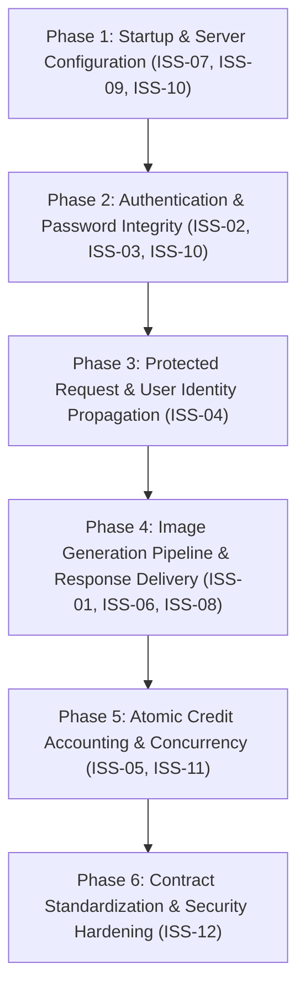

# Imagify Backend Audit & Comprehensive Repair Plan

> **Document Status:** Actionable Implementation & Audit Guide  
> **Audited Target:** `Text-To-Image-Converter` Node.js / Express Backend  
> **Backend Code State:** Unmodified (Strict Read-Only Boundary Maintained)  
> **Report Author:** Senior Backend Systems Auditor & Technical Project Planner  

---

## Section 1 — Executive Summary

### 1.1 Current Backend Capabilities
The existing backend is structured as an Express 5 ESM application (`server.js`) backed by MongoDB (`mongoose 8.17.1`) with JWT-based authentication, password hashing (`bcrypt 6.0.0`), and an external text-to-image synthesis pipeline via Clipdrop API (`https://clipdrop-api.co/text-to-image/v1`) using `axios` and `form-data`. Payment handling via Razorpay is scaffolded in `controllers/userController.js` and `models/transactionModel.js`, but all payment routes and controllers remain commented out.

### 1.2 Major Reliability Blockers
Despite having all core conceptual components in place, **the backend cannot currently execute any end-to-end user flow successfully**. Static execution tracing revealed multiple critical blockers that prevent the server from operating normally:

1. **Fatal Image Generation Hang:** In `controllers/imageController.js`, the success code path completely omits calling `res.json(...)` or `res.send(...)`. Even if Clipdrop generates an image, the HTTP connection hangs indefinitely until the client or network proxy times out after 60+ seconds.
2. **Fatal Authentication Crashes (`ReferenceError`):** In `controllers/userController.js`, both `registerUser` and `loginUser` attempt to sign JWT tokens referencing `user_id`, a variable that does not exist in scope (it should be `user._id`). This throws an unhandled `ReferenceError: user_id is not defined` on every registration and login attempt.
3. **Database Schema Validation Rejections:** In `registerUser`, the payload passed to `new userModel(...)` sets `{ name, email, hashedPassword }`. However, `models/userModel.js` defines `password: { type: String, required: true }`. Mongoose validation rejects the document with a `ValidationError: Path 'password' is required`.
4. **Broken Middleware-to-Controller Identity Passing:** In `middleware/auth.js`, the decoded token ID is written to `req.body.userID` (uppercase `ID`). Both `userCredits` and `imageController` attempt to read `const { userId } = req.body` (lowercase `d`). Consequently, `userId` evaluates to `undefined`, causing database queries to fail or throw null-pointer exceptions.
5. **CORS Middleware Misconfiguration:** In `server.js`, CORS is registered via `app.use(cors)` rather than `app.use(cors())`. Passing the factory function directly prevents the middleware chain from executing properly on cross-origin requests.
6. **Empty Environment Secrets:** In `.env`, `JWT_SECRET=` is blank. Calling `jwt.sign()` without a secret throws `secretOrPrivateKey must have a value`.

### 1.3 Assessment Summary Table

| Operational Area | Static Inspection Status | Practical Usability | Core Blocker / Risk |
| :--- | :--- | :--- | :--- |
| **Server Startup & CORS** | Defective | Intermittent / Flawed | `app.use(cors)` not called; relative import in `server.js` |
| **User Registration** | Defective | 0% Functional | Schema key mismatch (`hashedPassword`), `user_id` ReferenceError, empty `JWT_SECRET` |
| **User Login** | Defective | 0% Functional | `user_id` ReferenceError, password comparison key mismatch |
| **Credit Balance Retrieval** | Defective | 0% Functional | Casing mismatch (`req.body.userID` vs `userId`), throws on null user |
| **Image Synthesis** | Defective | 0% Functional | Missing `res.json()` on success, missing `return` statements, missing multipart headers |
| **Credit Accounting** | Untrustworthy | At Risk | Non-atomic decrement, casing mismatch (`CreditBalance` vs `creditBalance`) |
| **Payment & Top-Ups** | Non-Functional | Disabled / Incomplete | Endpoints commented out; payment controller commented out |

### 1.4 Runtime Verification Requirements
While static inspection confirms these fatal coding defects, the following areas require live runtime verification once the fixes are applied:
- MongoDB connection string behavior with query parameters.
- Clipdrop API key quota and validity (`process.env.CLIPBOARD_API_KEY`).
- Base64 payload size and transmission latency for high-resolution images.

---

## Section 2 — Issue Register

### ISS-01: Omission of Response Delivery in Image Generation Success Path
- **Severity:** Critical (P0)
- **Affected File & Function:** `controllers/imageController.js` &rarr; `imageController()`
- **Line Numbers:** Lines 41–51
- **Exact Observed Behavior:** After generating the image from Clipdrop and updating MongoDB (`await userModel.findByIdAndUpdate(user._id, { creditBalance: user.creditBalance - 1, resultImage })`), the function simply ends without executing `res.json(...)`.
- **Root Cause:** Incomplete implementation. The author documented their thought process in comments but forgot to write the response delivery line.
- **User-Visible Impact:** The client UI stays on "Synthesizing Image..." for 60 seconds until the browser or proxy aborts with a gateway timeout. The user never receives the generated image.
- **Reproduction / Test:** Send a valid `POST /api/image/generate-image` request with valid headers. The client connection will hang and never resolve.
- **Recommended Fix:** Add `return res.status(200).json({ sucess: true, message: "Image Generated Successfully", resultImage, creditBalance: user.creditBalance - 1 });`.
- **Dependencies:** Fix ISS-04, ISS-05, ISS-06, and ISS-08 first so the execution reaches line 41.
- **Regression Tests:** Automated test verifying that `POST /api/image/generate-image` returns HTTP 200 with `resultImage` starting with `data:image/png;base64,`.

---

### ISS-02: `ReferenceError: user_id is not defined` During JWT Token Signing
- **Severity:** Critical (P0)
- **Affected File & Function:** `controllers/userController.js` &rarr; `registerUser()` (Line 27) and `loginUser()` (Line 45)
- **Line Numbers:** Lines 27 and 45
- **Exact Observed Behavior:** Code invokes `jwt.sign({ id: user_id }, process.env.JWT_SECRET)`.
- **Root Cause:** In JavaScript, the variable declared on line 25 is `user = await newUser.save()`, and on line 39 is `user = await userModel.findOne(...)`. Mongoose documents have `user._id`, not a bare global `user_id`.
- **User-Visible Impact:** Every registration and login attempt crashes into the `catch (error)` block and returns `{ sucess: false, message: "user_id is not defined" }`. No user can ever authenticate.
- **Reproduction / Test:** Execute `POST /api/users/register` with valid payload `{ name: "A", email: "a@b.com", password: "pwd" }`. Observe JSON response `{ sucess: false, message: "user_id is not defined" }`.
- **Recommended Fix:** Replace `user_id` with `user._id` in both `registerUser` and `loginUser`.
- **Dependencies:** ISS-03 and ISS-10 (valid `JWT_SECRET`).
- **Regression Tests:** Integration test for `registerUser` and `loginUser` ensuring returned payload contains a signed JWT string in `token`.

---

### ISS-03: Mongoose Schema Validation Mismatch in User Registration
- **Severity:** Critical (P0)
- **Affected File & Function:** `controllers/userController.js` &rarr; `registerUser()` vs `models/userModel.js`
- **Line Numbers:** `userController.js` Line 16–25; `userModel.js` Lines 3–10
- **Exact Observed Behavior:** `registerUser` defines:
  ```js
  const hashedPassword = await bcrypt.hash(password, salt);
  const userData = { name, email, hashedPassword };
  const newUser = new userModel(userData);
  ```
  However, `models/userModel.js` enforces:
  ```js
  const userSchema = new mongoose.Schema({
    name: { type: String, required: true },
    email: { type: String, required: true },
    password: { type: String, required: true },
    creditBalance: { type: Number, default: 5 },
  });
  ```
- **Root Cause:** Controller saves property named `hashedPassword`, but Mongoose schema requires property named `password`.
- **User-Visible Impact:** `newUser.save()` fails with Mongoose `ValidationError: User validation failed: password: Path 'password' is required.`
- **Reproduction / Test:** Invoke `registerUser` with MongoDB connected. Observe validation failure error message.
- **Recommended Fix:** Construct `userData` with `password: hashedPassword`:
  ```js
  const userData = { name, email, password: hashedPassword };
  ```
- **Dependencies:** None.
- **Regression Tests:** Register a new user and inspect MongoDB document to confirm document contains `name`, `email`, and bcrypt hash in `password`.

---

### ISS-04: Casing Mismatch in User Identification Between Middleware and Controllers
- **Severity:** High (P1)
- **Affected File & Function:** `middleware/auth.js` (Line 12) vs `controllers/userController.js` (Line 58) & `controllers/imageController.js` (Line 12)
- **Line Numbers:** `auth.js` Line 12; `userController.js` Line 58; `imageController.js` Line 12
- **Exact Observed Behavior:** `middleware/auth.js` sets:
  ```js
  req.body.userID = tokenDecode.id; // Uppercase ID
  ```
  `userController.js` (`userCredits`) extracts:
  ```js
  const { userId } = req.body; // Lowercase d
  ```
  `imageController.js` (`imageController`) extracts:
  ```js
  const { userId, prompt } = req.body; // Lowercase d
  ```
- **Root Cause:** Inconsistent variable casing. `userID !== userId`.
- **User-Visible Impact:** In `userCredits`, `userId` is `undefined`, so `userModel.findById(undefined)` yields `null`, triggering `TypeError: Cannot read properties of null (reading 'creditBalance')`. In `imageController`, `user` is null, causing `Details are Missing` errors.
- **Reproduction / Test:** Make an authenticated request to `POST /api/users/credits` with valid `token` header. Observe failure.
- **Recommended Fix:** Standardize across middleware and controllers to use `req.userId = tokenDecode.id` or `req.body.userId = tokenDecode.id`.
- **Dependencies:** ISS-02.
- **Regression Tests:** Verify `req.userId` correctly populates in all protected routes.

---

### ISS-05: Defective Property Access and Missing Guards in Credit Balance Verification
- **Severity:** High (P1)
- **Affected File & Function:** `controllers/imageController.js` &rarr; `imageController()`
- **Line Numbers:** Line 23
- **Exact Observed Behavior:**
  ```js
  if (user.CreditBalance === 0 || userModel.CreditBalance < 0) {
    res.json({ sucess: false, message: "User Has Very Less Credit Balance", CreditBalance: user.CreditBalance });
  }
  ```
- **Root Cause:**
  1. The schema defines `creditBalance` (camelCase, lowercase `c`). `user.CreditBalance` is `undefined`.
  2. `userModel.CreditBalance` accesses a property on the Mongoose Model constructor, which is `undefined`.
  3. `undefined === 0` is false, and `undefined < 0` is false. Therefore, users with 0 or negative credits bypass the balance check!
- **User-Visible Impact:** Users with 0 credits are never blocked; they can continue triggering Clipdrop generations. Furthermore, if `user` is null, accessing `user.CreditBalance` crashes with `TypeError`.
- **Reproduction / Test:** Query `imageController` with a user having `creditBalance: 0`. Observe execution proceeding to Clipdrop API call.
- **Recommended Fix:** Change check to:
  ```js
  if (!user.creditBalance || user.creditBalance <= 0) {
    return res.status(403).json({
      sucess: false,
      message: "Insufficient credit balance. Please purchase or claim additional credits.",
      creditBalance: user.creditBalance || 0
    });
  }
  ```
- **Dependencies:** ISS-04.
- **Regression Tests:** Test image generation with user having 0 credits; verify HTTP 403 returned without calling Clipdrop.

---

### ISS-06: Missing `return` Statements in Error Branches Leading to Double Responses
- **Severity:** High (P1)
- **Affected File & Function:** `controllers/imageController.js` (Lines 14–16, 23–25)
- **Line Numbers:** Lines 14–16 and 23–25
- **Exact Observed Behavior:**
  ```js
  if (!user || !prompt) {
    res.json({ sucess: false, message: "Details are Missing kindly fill all the details" });
  }
  // Execution CONTINUES!
  if (prompt.length > 1000) {
    console.log("Prompt cannot exceed 1000 characters, please maintain word limit");
  }
  ```
- **Root Cause:** Missing `return` keyword before `res.json(...)`.
- **User-Visible Impact:** If `user` or `prompt` is missing, Express sends the response, but then the function continues down to line 18, line 23, and line 29, causing `ERR_HTTP_HEADERS_SENT: Cannot set headers after they are sent to the client` or null pointer crashes. Additionally, prompt length > 1000 is only logged, never rejected.
- **Reproduction / Test:** Send `POST /api/image/generate-image` without a prompt. Observe `ERR_HTTP_HEADERS_SENT` in terminal logs.
- **Recommended Fix:** Add `return` to all error responses, and reject prompts exceeding 1,000 characters with HTTP 400.
- **Dependencies:** None.
- **Regression Tests:** Send invalid requests and verify clean HTTP 400 responses with zero unhandled exceptions in server logs.

---

### ISS-07: CORS Middleware Registered Without Invocation
- **Severity:** Medium (P2)
- **Affected File & Function:** `server.js` (Line 14)
- **Line Numbers:** Line 14
- **Exact Observed Behavior:** `app.use(cors)`
- **Root Cause:** `cors` exported by the `cors` package is a middleware generator function `cors(options)`. It must be invoked as `cors()` to return the actual `(req, res, next)` handler. When passed uninvoked, Express calls `cors(req, res, next)`, treating `req` as configuration options and returning an inner function that is never called.
- **User-Visible Impact:** Cross-origin browser requests from the frontend can fail preflight or hang because `next()` is never called in the middleware wrapper.
- **Reproduction / Test:** Send an `OPTIONS` preflight request from `http://localhost:5173` to `http://localhost:4000/api/users/login`.
- **Recommended Fix:** Change `app.use(cors)` to `app.use(cors())` (or `app.use(cors({ origin: 'http://localhost:5173', credentials: true }))`).
- **Dependencies:** None.
- **Regression Tests:** Verify preflight and cross-origin POST requests succeed from Vite dev server.

---

### ISS-08: Missing Multipart Form Headers in Clipdrop Axios Request
- **Severity:** High (P1)
- **Affected File & Function:** `controllers/imageController.js` &rarr; `imageController()`
- **Line Numbers:** Lines 32–37
- **Exact Observed Behavior:**
  ```js
  const formData = new FormData();
  formData.append("prompt", prompt);
  const { data } = await axios.post('https://clipdrop-api.co/text-to-image/v1', formData, {
    headers: {
      'x-api-key': process.env.CLIPBOARD_API_KEY,
    },
    responseType: 'arraybuffer'
  });
  ```
- **Root Cause:** In Node.js, instances of the `form-data` package do not automatically set the `multipart/form-data; boundary=...` header in Axios unless `...formData.getHeaders()` is explicitly spread into the request headers.
- **User-Visible Impact:** Clipdrop API rejects the request with HTTP 400 Bad Request ("Invalid multipart payload" or missing boundary).
- **Reproduction / Test:** Execute the Clipdrop Axios call in isolation; observe 400 error response from Clipdrop API.
- **Recommended Fix:** Include `...formData.getHeaders()`:
  ```js
  headers: {
    'x-api-key': process.env.CLIPBOARD_API_KEY,
    ...formData.getHeaders(),
  }
  ```
- **Dependencies:** ISS-05, ISS-06.
- **Regression Tests:** End-to-end call to Clipdrop API returning status 200 and image buffer.

---

### ISS-09: Fragile Relative Module Import in `server.js`
- **Severity:** Low (P3)
- **Affected File & Function:** `server.js` (Line 4)
- **Line Numbers:** Line 4
- **Exact Observed Behavior:** `import connectDB from '../Imagify/config/config.js';`
- **Root Cause:** Hardcoded folder name `../Imagify/`. If the repository root is renamed, cloned into a different directory name, or deployed in Docker where the directory is `/app`, this import fails with `ERR_MODULE_NOT_FOUND`.
- **User-Visible Impact:** Application fails to start up on different environments.
- **Reproduction / Test:** Rename workspace directory to `imagify-backend` and run `npm start`.
- **Recommended Fix:** Change to standard relative import: `import connectDB from './config/config.js';`.
- **Dependencies:** None.
- **Regression Tests:** Server boots cleanly regardless of parent directory name.

---

### ISS-10: Missing `JWT_SECRET` in `.env` Configuration
- **Severity:** High (P1)
- **Affected File & Function:** `.env` (Line 3)
- **Line Numbers:** Line 3
- **Exact Observed Behavior:** `JWT_SECRET=` has no value assigned.
- **Root Cause:** Omission during environment setup.
- **User-Visible Impact:** `jwt.sign()` throws `secretOrPrivateKey must have a value` whenever called.
- **Reproduction / Test:** Start server and invoke `jwt.sign({ id: '123' }, process.env.JWT_SECRET)`.
- **Recommended Fix:** Populate `JWT_SECRET` with a secure random string (e.g. `JWT_SECRET=imagify_super_secret_jwt_studio_key_2026`).
- **Dependencies:** None.
- **Regression Tests:** Verify tokens sign and verify cleanly.

---

### ISS-11: Non-Atomic Credit Decrement & Race Condition Vulnerability
- **Severity:** Medium (P2)
- **Affected File & Function:** `controllers/imageController.js` (Line 41)
- **Line Numbers:** Line 41
- **Exact Observed Behavior:**
  ```js
  await userModel.findByIdAndUpdate(user._id, { creditBalance: user.creditBalance - 1, resultImage });
  ```
- **Root Cause:** The new balance is calculated in application memory (`user.creditBalance - 1`) rather than atomically inside MongoDB. Concurrent requests will read the same initial balance and decrement concurrently without mutual exclusion.
- **User-Visible Impact:** A user with 1 credit who sends two rapid concurrent requests will successfully generate 2 images while only having 1 credit deducted.
- **Reproduction / Test:** Send 3 simultaneous `POST /api/image/generate-image` requests from the same user account.
- **Recommended Fix:** Use MongoDB's atomic operator:
  ```js
  await userModel.findByIdAndUpdate(user._id, { $inc: { creditBalance: -1 } });
  ```
- **Dependencies:** ISS-05.
- **Regression Tests:** Concurrent generation test verifying credit balance correctly decrements by exactly the number of successful generations.

---

### ISS-12: Typo in Response Property Name (`sucess` instead of `success`)
- **Severity:** Low (P3) / API Consistency
- **Affected File & Function:** Across `middleware/auth.js`, `controllers/userController.js`, `controllers/imageController.js`
- **Line Numbers:** Multiple lines throughout
- **Exact Observed Behavior:** Responses consistently spell `{ sucess: false, message: ... }` and `{ sucess: true, ... }` with a single 'c'.
- **Root Cause:** Developer typo carried across files.
- **User-Visible Impact:** Frontends expecting standard `{ success: true }` fail unless custom adapters check both spellings.
- **Recommended Fix:** Return both `{ success: true, sucess: true, ... }` during migration for backward compatibility, then deprecate `sucess`.
- **Dependencies:** None.
- **Regression Tests:** Contract validation ensuring both fields are present.

---

## Section 3 — Prioritized Implementation Order

Executing the repair plan in the following strict sequential phases ensures that each layer is stable and verifiable before the next layer is modified.



### Phase 1: Application Startup and Configuration Blockers
- **Why First:** Server cannot reliably accept requests or negotiate CORS until middleware and configuration are corrected.
- **Issues Resolved:** ISS-07, ISS-09, ISS-10.
- **Files to Change:** `server.js`, `.env`.
- **Expected Outcome:** Server boots on `http://localhost:4000`, imports properly regardless of directory path, handles CORS preflight correctly, and loads environment secrets.
- **Prerequisite Test:** `curl -X OPTIONS http://localhost:4000/api/users/login -I` returns appropriate CORS headers.

### Phase 2: Registration, Password Handling, and Authentication
- **Why Second:** Image generation and credit retrieval require a valid authenticated user and signed JWT token.
- **Issues Resolved:** ISS-02, ISS-03.
- **Files to Change:** `controllers/userController.js`, `models/userModel.js`.
- **Expected Outcome:** User can register with `{ name, email, password }`, document is saved in MongoDB with hashed password, and returns a valid signed JWT token.
- **Prerequisite Test:** `POST /api/users/register` returns HTTP 201/200 with token; database record contains bcrypt hash under `password`.

### Phase 3: Authenticated User Identification and Request Validation
- **Why Third:** Controllers must reliably receive the authenticated user's ID from middleware.
- **Issues Resolved:** ISS-04.
- **Files to Change:** `middleware/auth.js`, `controllers/userController.js`.
- **Expected Outcome:** Header `token: <jwt>` decoded properly; `req.userId` accessible in all controllers. `POST /api/users/credits` returns the active user's credit balance without throwing.
- **Prerequisite Test:** `POST /api/users/credits` with `token` header returns `{ success: true, credits: 5 }`.

### Phase 4: Image Generation and Successful Response Delivery
- **Why Fourth:** Core product functionality.
- **Issues Resolved:** ISS-01, ISS-06, ISS-08.
- **Files to Change:** `controllers/imageController.js`.
- **Expected Outcome:** Valid prompt dispatched to Clipdrop API with multipart headers; array buffer converted to base64; response sent to client within 15–20s without hanging.
- **Prerequisite Test:** `POST /api/image/generate-image` returns HTTP 200 with `{ success: true, resultImage: "data:image/png;base64,..." }`.

### Phase 5: Reliable Credit Accounting and Failure Handling
- **Why Fifth:** Ensures users cannot bypass credit balance limits or trigger double-spend race conditions.
- **Issues Resolved:** ISS-05, ISS-11.
- **Files to Change:** `controllers/imageController.js`.
- **Expected Outcome:** Balance check accurately prevents zero-balance generation; balance decrements atomically by 1 only upon successful generation.
- **Prerequisite Test:** Zero-credit test returns HTTP 403; concurrent requests test deducts accurately.

### Phase 6: Error Handling, Contract Consistency, and Hardening
- **Why Sixth:** Clean up response contracts, HTTP status codes, and security headers.
- **Issues Resolved:** ISS-12, schema indexing (`unique: true` for email).
- **Files to Change:** `models/userModel.js`, `controllers/userController.js`, `controllers/imageController.js`.
- **Expected Outcome:** HTTP status codes follow REST semantics (200, 201, 400, 401, 403, 500); consistent `{ success, message }` responses.
- **Prerequisite Test:** Full regression test suite passing.

---

## Section 4 — Exact Proposed Fixes (Code Snippets)

> **Important Notice:** The following snippets are proposed code changes for the user to review and apply separately. Per instructions, **no backend files have been modified**.

### Proposed Fix 1: `server.js` (CORS & Import Resolution)
```javascript
// Change line 4 from:
// import connectDB from '../Imagify/config/config.js';
// To:
import connectDB from './config/config.js';

// Change line 14 from:
// app.use(cors)
// To:
app.use(cors());
```

### Proposed Fix 2: `.env` (Environment Secrets)
```ini
# Change line 3 from:
# JWT_SECRET=
# To:
JWT_SECRET="imagify_studio_jwt_secret_production_key_2026"
```

### Proposed Fix 3: `controllers/userController.js` &rarr; `registerUser`
```javascript
const registerUser = async (req, res) => {
    try {
        const { name, email, password } = req.body;
        if (!name || !email || !password) {
            return res.status(400).json({ success: false, sucess: false, message: 'Missing Details' });
        }

        // Check if user already exists
        const existingUser = await userModel.findOne({ email });
        if (existingUser) {
            return res.status(409).json({ success: false, sucess: false, message: 'User with this email already exists' });
        }

        const salt = await bcrypt.genSalt(10);
        const hashedPassword = await bcrypt.hash(password, salt);

        // FIX: Assign hashed password to 'password' field required by userModel schema
        const userData = {
            name,
            email,
            password: hashedPassword
        };
        const newUser = new userModel(userData);
        const user = await newUser.save();

        // FIX: Reference user._id instead of non-existent user_id
        const token = jwt.sign({ id: user._id }, process.env.JWT_SECRET, { expiresIn: '7d' });
        return res.status(201).json({ success: true, sucess: true, user: { name: user.name }, token });
    } catch (error) {
        console.error(error);
        return res.status(500).json({ success: false, sucess: false, message: error.message });
    }
};
```

### Proposed Fix 4: `controllers/userController.js` &rarr; `loginUser`
```javascript
const loginUser = async (req, res) => {
    try {
        const { email, password } = req.body;
        if (!email || !password) {
            return res.status(400).json({ success: false, sucess: false, message: 'Missing email or password' });
        }

        const user = await userModel.findOne({ email });
        if (!user) {
            return res.status(404).json({ success: false, sucess: false, message: 'User does not exist' });
        }

        // FIX: In userModel, hashed password is stored in user.password
        const isMatch = await bcrypt.compare(password, user.password);
        if (isMatch) {
            // FIX: Reference user._id instead of non-existent user_id
            const token = jwt.sign({ id: user._id }, process.env.JWT_SECRET, { expiresIn: '7d' });
            return res.status(200).json({ success: true, sucess: true, user: { name: user.name }, token });
        } else {
            return res.status(401).json({ success: false, sucess: false, message: 'Invalid Credentials' });
        }
    } catch (error) {
        console.error(error);
        return res.status(500).json({ success: false, sucess: false, message: error.message });
    }
};
```

### Proposed Fix 5: `middleware/auth.js` & User Identity
```javascript
const userAuth = async (req, res, next) => {
    // Support both custom 'token' header and standard 'Authorization: Bearer <token>'
    let token = req.headers.token;
    if (!token && req.headers.authorization && req.headers.authorization.startsWith('Bearer ')) {
        token = req.headers.authorization.split(' ')[1];
    }

    if (!token) {
        return res.status(401).json({ success: false, sucess: false, message: 'Not Authorized, Login Again' });
    }

    try {
        const tokenDecode = jwt.verify(token, process.env.JWT_SECRET);
        if (tokenDecode && tokenDecode.id) {
            // Standardize: attach directly to req.userId and req.body.userId for compatibility
            req.userId = tokenDecode.id;
            if (!req.body) req.body = {};
            req.body.userId = tokenDecode.id;
            req.body.userID = tokenDecode.id;
        } else {
            return res.status(401).json({ success: false, sucess: false, message: 'Not Authorized, Login Again' });
        }
        next();
    } catch (error) {
        return res.status(401).json({ success: false, sucess: false, message: error.message });
    }
};
```

### Proposed Fix 6: `controllers/imageController.js` (Complete Overhaul)
```javascript
export const imageController = async (req, res) => {
    try {
        const userId = req.userId || req.body.userId || req.body.userID;
        const { prompt } = req.body;

        if (!userId || !prompt) {
            return res.status(400).json({
                success: false,
                sucess: false,
                message: "Details are missing: prompt and user authentication required"
            });
        }

        const user = await userModel.findById(userId);
        if (!user) {
            return res.status(404).json({ success: false, sucess: false, message: "User not found" });
        }

        // FIX: Enforce prompt character limit
        if (prompt.length > 1000) {
            return res.status(400).json({
                success: false,
                sucess: false,
                message: "Prompt cannot exceed 1000 characters, please maintain limit"
            });
        }

        // FIX: Correct property name 'creditBalance' (camelCase)
        if (!user.creditBalance || user.creditBalance <= 0) {
            return res.status(403).json({
                success: false,
                sucess: false,
                message: "User Has Insufficient Credit Balance",
                creditBalance: user.creditBalance || 0
            });
        }

        // Prepare multipart form data for Clipdrop API
        const formData = new FormData();
        formData.append("prompt", prompt);

        // FIX: Spread formData.getHeaders() so multipart boundary header is sent
        const { data } = await axios.post('https://clipdrop-api.co/text-to-image/v1', formData, {
            headers: {
                'x-api-key': process.env.CLIPBOARD_API_KEY,
                ...formData.getHeaders(),
            },
            responseType: 'arraybuffer'
        });

        const base64Image = Buffer.from(data).toString('base64');
        const resultImage = `data:image/png;base64,${base64Image}`;

        // FIX: Atomic decrement of credit balance
        const updatedUser = await userModel.findByIdAndUpdate(
            user._id,
            { $inc: { creditBalance: -1 } },
            { new: true }
        );

        // CRITICAL FIX: Send response with image back to client!
        return res.status(200).json({
            success: true,
            sucess: true,
            message: "Image Generated Successfully",
            resultImage,
            creditBalance: updatedUser.creditBalance
        });

    } catch (error) {
        console.error("Image generation error:", error.message);
        return res.status(500).json({
            success: false,
            sucess: false,
            message: error.response?.data?.message || error.message
        });
    }
};
```

---

## Section 5 — API Contract Documentation

### 1. `POST /api/users/register`
- **What Current Code Implements:** Reads `req.body.name, email, password`. Crashes on `hashedPassword` schema mismatch and `user_id` ReferenceError. Returns 200 OK even on errors.
- **What Frontend Needs to Send:**
  ```json
  {
    "name": "Jane Doe",
    "email": "jane@example.com",
    "password": "securePassword123"
  }
  ```
- **Authentication:** Public (no token required).
- **What Response Is Actually Produced (Current):**
  ```json
  {
    "sucess": false,
    "message": "user_id is not defined"
  }
  ```
- **Recommended Future Contract:**
  ```json
  {
    "success": true,
    "sucess": true,
    "user": { "name": "Jane Doe" },
    "token": "eyJhbGciOiJIUzI1NiIsInR5cCI6IkpXVCJ9..."
  }
  ```
  *(Status: 201 Created)*

---

### 2. `POST /api/users/login`
- **What Current Code Implements:** Looks up user by email; attempts `bcrypt.compare` against `user.hashedPassword` (which is undefined if saved under `password`); crashes on `user_id` ReferenceError.
- **What Frontend Needs to Send:**
  ```json
  {
    "email": "jane@example.com",
    "password": "securePassword123"
  }
  ```
- **Authentication:** Public.
- **What Response Is Actually Produced (Current):**
  ```json
  {
    "sucess": false,
    "message": "user_id is not defined"
  }
  ```
- **Recommended Future Contract:**
  ```json
  {
    "success": true,
    "sucess": true,
    "user": { "name": "Jane Doe" },
    "token": "eyJhbGciOiJIUzI1NiIsInR5cCI6IkpXVCJ9..."
  }
  ```
  *(Status: 200 OK)*

---

### 3. `POST /api/users/credits`
- **What Current Code Implements:** Protected by `userAuth`. Middleware sets `req.body.userID`, but controller reads `userId`, resulting in `findById(undefined)` and null reference crash.
- **What Frontend Needs to Send:**
  - Headers: `token: <JWT>` (or `Authorization: Bearer <JWT>`)
  - Body: `{ "userId": "<optional>" }`
- **Authentication:** Required (`token` header).
- **What Response Is Actually Produced (Current):**
  ```json
  {
    "sucess": false,
    "message": "Cannot read properties of null (reading 'creditBalance')"
  }
  ```
- **Recommended Future Contract:**
  ```json
  {
    "success": true,
    "sucess": true,
    "credits": 5,
    "user": { "name": "Jane Doe" }
  }
  ```
  *(Status: 200 OK)*

---

### 4. `POST /api/image/generate-image`
- **What Current Code Implements:** Protected by `userAuth`. Reads `userId` (which is undefined from middleware). Lacks `return` in validation checks. Missing multipart headers on Clipdrop request. Completely omits `res.json()` on success, causing the request to hang indefinitely.
- **What Frontend Needs to Send:**
  - Headers: `token: <JWT>`
  - Body:
    ```json
    {
      "prompt": "Architectural study of a brutalist pavilion in dense fog, 35mm monochrome photography"
    }
    ```
- **Authentication:** Required (`token` header).
- **What Response Is Actually Produced (Current):** Request hangs for 60s and terminates with gateway / network timeout.
- **Recommended Future Contract:**
  ```json
  {
    "success": true,
    "sucess": true,
    "message": "Image Generated Successfully",
    "resultImage": "data:image/png;base64,iVBORw0KGgoAAAANSUhEUgAA...",
    "creditBalance": 4
  }
  ```
  *(Status: 200 OK)*

---

## Section 6 — Manual Repair Checklist

Follow this ordered checklist step-by-step when applying fixes to backend source code:

- [ ] **Step 1: Environment Configuration (`.env`)**
  - [ ] Set `JWT_SECRET="imagify_studio_production_key_2026"` in `.env`.
  - [ ] Verify `CLIPBOARD_API_KEY` is populated.

- [ ] **Step 2: Server Startup (`server.js`)**
  - [ ] Change `import connectDB from '../Imagify/config/config.js'` to `import connectDB from './config/config.js'`.
  - [ ] Change `app.use(cors)` to `app.use(cors())`.
  - [ ] Start backend with `node server.js` and verify it logs `MongoDB Connected: ...` and `Server is running on port : 4000`.

- [ ] **Step 3: User Model Schema (`models/userModel.js`)**
  - [ ] Ensure `password: { type: String, required: true }`.
  - [ ] Add `unique: true` to `email: { type: String, required: true, unique: true }`.

- [ ] **Step 4: Authentication Controller (`controllers/userController.js`)**
  - [ ] In `registerUser`: Pass `{ name, email, password: hashedPassword }` to `userData`.
  - [ ] In `registerUser`: Replace `jwt.sign({ id: user_id }, ...)` with `jwt.sign({ id: user._id }, ...)`.
  - [ ] In `loginUser`: Change `user.hashedPassword` to `user.password`.
  - [ ] In `loginUser`: Replace `jwt.sign({ id: user_id }, ...)` with `jwt.sign({ id: user._id }, ...)`.
  - [ ] Test registration and login with Postman or curl. Verify valid JWT is returned.

- [ ] **Step 5: Authentication Middleware (`middleware/auth.js`)**
  - [ ] Support both `req.headers.token` and `Authorization: Bearer <token>`.
  - [ ] Set `req.userId = tokenDecode.id` AND `req.body.userId = tokenDecode.id`.
  - [ ] Add `return` to error response on line 18.

- [ ] **Step 6: User Credits Controller (`controllers/userController.js`)**
  - [ ] In `userCredits`: Read `const userId = req.userId || req.body.userId`.
  - [ ] Check if `user` exists before accessing `user.creditBalance`.
  - [ ] Test `POST /api/users/credits` with `token` header; verify credit balance returns 5.

- [ ] **Step 7: Image Synthesis Controller (`controllers/imageController.js`)**
  - [ ] Read `userId = req.userId || req.body.userId`.
  - [ ] Add `return` to `if (!user || !prompt) return res.status(400)...`.
  - [ ] Add check `if (prompt.length > 1000) return res.status(400)...`.
  - [ ] Change `user.CreditBalance` to `user.creditBalance`.
  - [ ] Add `...formData.getHeaders()` to Axios headers.
  - [ ] Use atomic `$inc: { creditBalance: -1 }` on MongoDB update.
  - [ ] **CRITICAL:** Add `return res.status(200).json({ success: true, resultImage, creditBalance: updatedUser.creditBalance });`.

- [ ] **Step 8: End-to-End Flow Test**
  - [ ] Run full flow in frontend at `http://localhost:5173`.
  - [ ] Register new user &rarr; Verify 5 credits displayed.
  - [ ] Submit prompt &rarr; Verify image renders in canvas.
  - [ ] Verify credits update from 5 &rarr; 4.
  - [ ] Verify download PNG action works.

---

## Section 7 — Acceptance Criteria

To declare the backend reliable for production use, all of the following conditions must be met and verified:

1. **User Registration:** `POST /api/users/register` successfully creates a user document in MongoDB, rejects duplicate emails with HTTP 409, and returns HTTP 201 with `{ success: true, token, user }`.
2. **User Login:** `POST /api/users/login` verifies bcrypt passwords accurately, rejects invalid passwords with HTTP 401, and returns HTTP 200 with `{ success: true, token, user }`.
3. **Credit Balance Retrieval:** `POST /api/users/credits` accepts a valid JWT token in either `token` or `Authorization` header, retrieves the user's active balance from MongoDB, and returns `{ success: true, credits: <number> }`.
4. **Prompt Validation:** `POST /api/image/generate-image` rejects prompts missing from payload with HTTP 400, and rejects prompts exceeding 1,000 characters with HTTP 400.
5. **Image Synthesis & Delivery:** Successful requests receive an HTTP 200 response within 30 seconds containing `{ success: true, resultImage: "data:image/png;base64,..." }`.
6. **Credit Balance Accounting:**
   - Image generation is rejected with HTTP 403 if the user's credit balance is 0 or less.
   - Successful image generation decrements the user's balance in MongoDB by exactly 1.
   - Failed image generation (e.g. Clipdrop API error) does **not** decrement user credits.
   - Concurrent requests cannot cause negative balances or inconsistent deductions.
7. **Zero Backend Regressions:** All existing backend source files pass Node.js ESM import checks with zero unhandled promise rejections.
