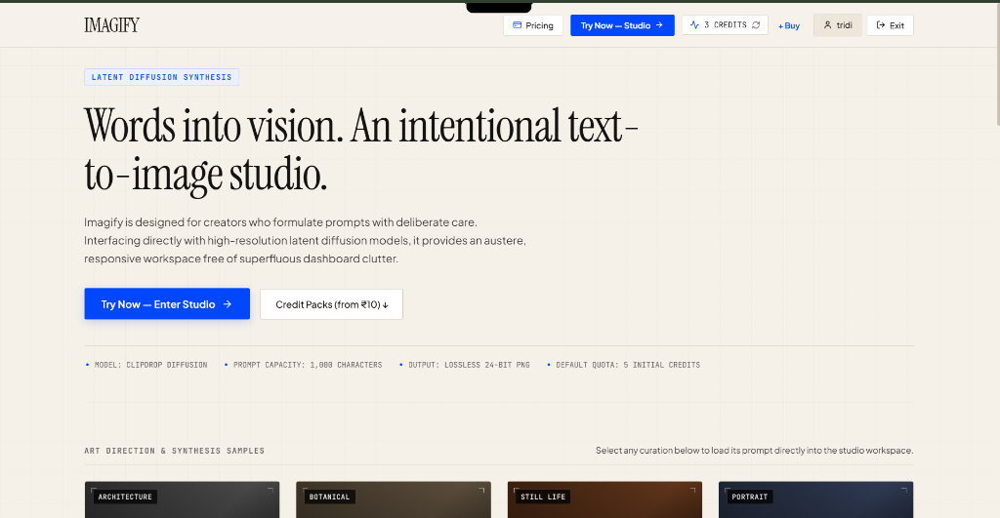
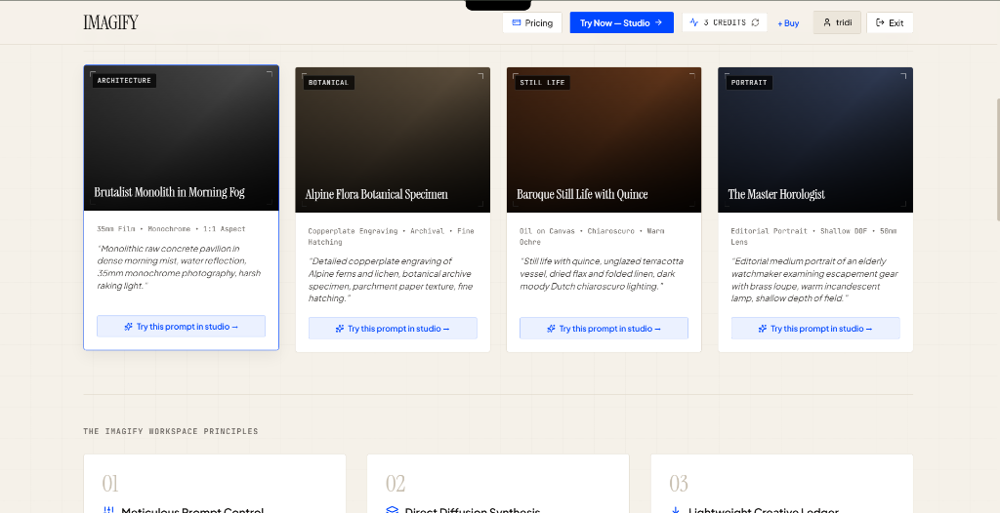
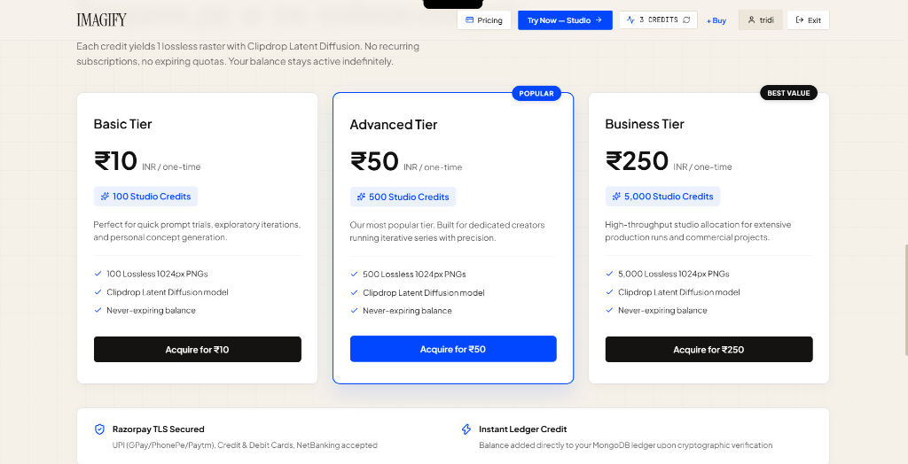
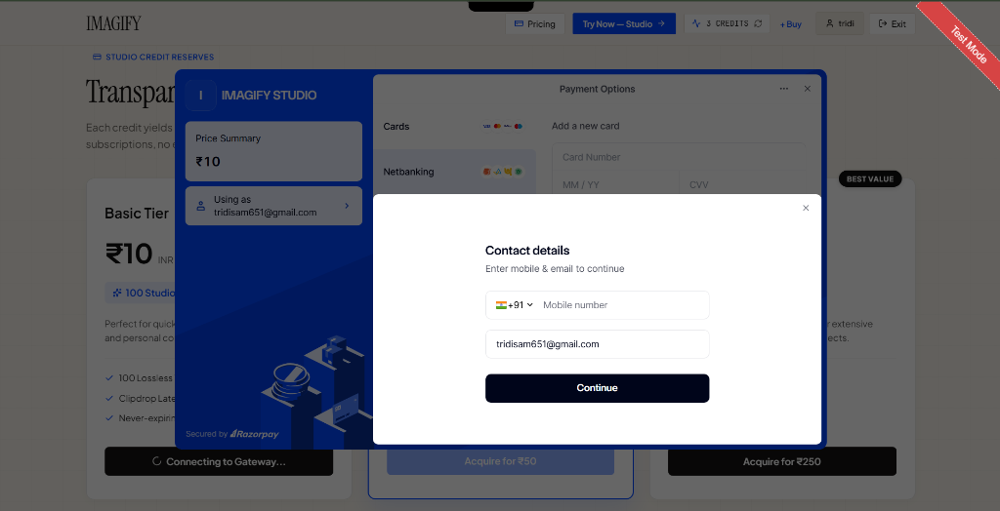
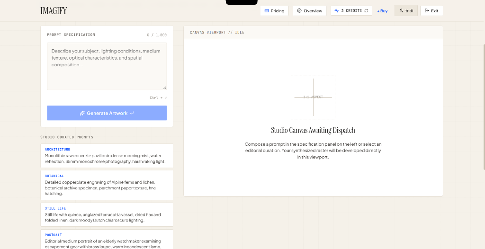
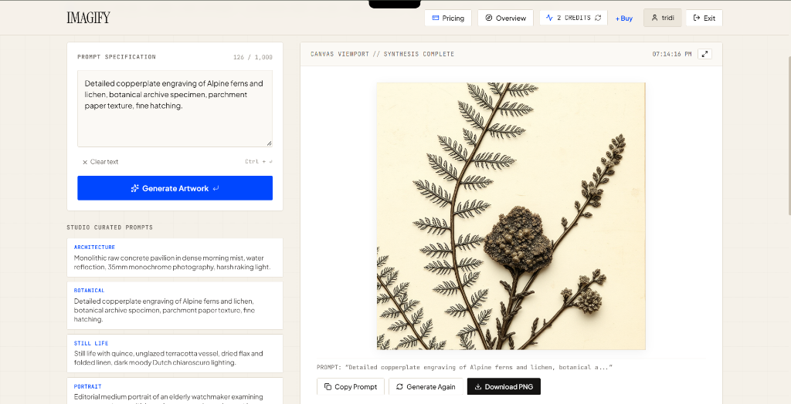
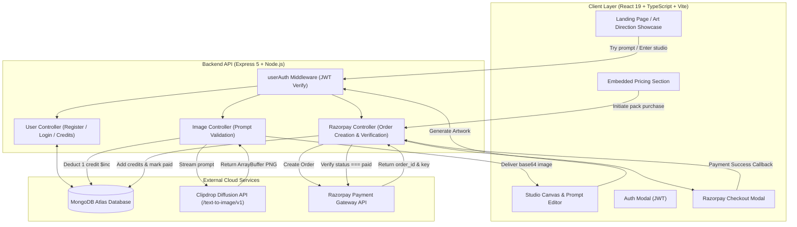

# IMAGIFY &mdash; Editorial Text-to-Image AI Studio

<div align="center">

[](https://opensource.org/licenses/ISC)
[](https://react.dev/)
[](https://www.typescriptlang.org/)
[](https://vitejs.dev/)
[](https://nodejs.org/)
[](https://expressjs.com/)
[](https://www.mongodb.com/)
[](https://razorpay.com/)
[](https://text-to-image-converter-d0pf.onrender.com)

**An intentional, production-grade text-to-image synthesis studio engineered with a distinctive editorial aesthetic, high-resolution Clipdrop diffusion models, atomic credit accounting, and seamless Razorpay payment processing.**

[Live Backend API](https://text-to-image-converter-d0pf.onrender.com) &bull; [GitHub Repository](https://github.com/TridibeshSam31/Text-To-Image-Converter) &bull; [Contact Author](mailto:tridisam651@gmail.com)

</div>

---

## Table of Contents

- [Overview](#overview)
- [Visual Interface & Screenshots](#visual-interface--screenshots)
- [Design Philosophy](#design-philosophy)
- [Key Features](#key-features)
- [System Architecture](#system-architecture)
- [Tech Stack](#tech-stack)
- [API Documentation](#api-documentation)
- [Project Structure](#project-structure)
- [Getting Started Locally](#getting-started-locally)
  - [Prerequisites](#prerequisites)
  - [Environment Configuration](#environment-configuration)
  - [Running the Backend](#running-the-backend)
  - [Running the Frontend](#running-the-frontend)
- [Deployment Guide](#deployment-guide)
  - [Deploying Backend to Render](#deploying-backend-to-render)
  - [Deploying Frontend to Vercel](#deploying-frontend-to-vercel)
- [Troubleshooting & Gotchas](#troubleshooting--gotchas)
- [License & Contact](#license--contact)

---

## Overview

**Imagify** is a full-stack text-to-image creation platform built for creators, designers, and prompt engineers who value typographic restraint, prompt precision, and zero dashboard bloat. Instead of generic SaaS purple gradients and heavy glassmorphism, Imagify pairs a tactile, warm editorial canvas (`Instrument Serif` + `Plus Jakarta Sans`) with a high-throughput latent diffusion synthesis pipeline.

Users receive **5 complimentary credits** upon registration. Each generation query streams binary ArrayBuffers directly from the **Clipdrop AI API**, rendering high-resolution, uncompressed 24-bit PNG rasters. Additional credits can be purchased securely through **Razorpay** with automated ledger updates in MongoDB.

---

## Visual Interface & Screenshots

<div align="center">

### 1. Editorial Landing Page & Hero
*Warm archival paper canvas with clean typographic hierarchy, telemetry badges, and 1-click studio entry.*

<p align="center">
  
</p>

<br />

### 2. Art Direction & Curated Prompt Inspirations
*Curated samples with 1-click loading directly into the studio workspace.*

<p align="center">
  
</p>

<br />

### 3. Studio Credit Reserves & Pricing (Pure White Cards)
*Pure white elevated pricing cards with zero recurring subscriptions and lifetime validity.*

<p align="center">
  
</p>

<br />

### 4. Live Razorpay Gateway Checkout
*Enterprise TLS-secured payment modal supporting UPI, Cards, and NetBanking.*

<p align="center">
  
</p>

<br />

### 5. Intentional Studio Workspace (Awaiting Dispatch)
*Minimalist synthesis canvas with 1,000-character capacity, Ctrl + Enter execution, real-time credit telemetry, and curated prompt shortcuts.*

<p align="center">
  
</p>

<br />

### 6. Synthesis Complete & Generated Artwork Output
*Live Clipdrop diffusion rasterization with Alpine botanical engraving preview, instant prompt copying, generation replay, and 1-click lossless PNG export.*

<p align="center">
  
</p>

</div>

---

## Design Philosophy

- **Tactile Editorial Surfaces**: Built with warm archival paper textures (`#F7F5F0`), crisp ink borders (`#111111` / `#E2E2E0`), and electric cobalt blue (`#0047FF`) as a singular focal accent.
- **Editorial Typography**: Pairing classical display serif headings (`Instrument Serif`) with clean, utilitarian grotesque copy (`Plus Jakarta Sans`) and monospace telemetry (`JetBrains Mono`).
- **Telemetry-Driven Prompting**: Live character counters enforcing a 1,000-character boundary with visual warning states, keyboard shortcuts (`Ctrl + Enter`), and curated architectural/botanical inspiration.
- **Zero Fluff**: No extraneous dashboard widgets, artificial loading timers, or deceptive progress indicators.

---

## Key Features

### 1. Editorial Landing Page & Showcase
- Curated art direction showcase cards featuring architectural, botanical, still-life, and editorial portrait prompts.
- **1-Click Prompt Loading**: Click *"Try this prompt in studio &rarr;"* to transfer prompts directly to the studio canvas.
- Integrated **Credit Packs & Pricing section** with pure white elevated cards and live Razorpay checkout.

### 2. Studio Workspace & Precision Prompt Editor
- 1,000-character capacity prompt textarea with live character limit meters.
- Dual synthesis trigger: Primary action button and `Ctrl + Enter` (or `Cmd + Enter`) hotkey.
- 4 curated studio inspiration categories for rapid concept formulation.

### 3. Latent Diffusion Synthesis & Canvas
- Direct binary ArrayBuffer parsing into lossless `data:image/png;base64` delivery.
- State-driven canvas modes: `empty`, `loading` (laser scan animation), `success`, and `error`.
- Full-resolution lossless PNG download trigger.

### 4. Strict Authentication & Protected Routes
- Custom navigation middleware (`isAuthenticated`) guarding the studio canvas and image trials.
- Clean modal sign-in / registration with bcrypt hashing (10 salt rounds) and signed JWT tokens.
- Automatic transition: Unauthenticated users selecting prompts are prompted to authenticate, and upon login, their selected prompt is seamlessly transferred to the active workspace.

### 5. Razorpay Payment Gateway & Credit Ledger
- Complete MERN Razorpay payment cycle: Order creation &rarr; Client Checkout Modal &rarr; Cryptographic Verification &rarr; Ledger update.
- 3 transparent tiers:
  - **Basic**: 100 Credits &bull; ₹10
  - **Advanced [POPULAR]**: 500 Credits &bull; ₹50
  - **Business [BEST VALUE]**: 5,000 Credits &bull; ₹250
- Atomic credit balance adjustments using MongoDB `$inc` operators.

### 6. Session Gallery
- Session-level archival gallery persisting recent synthesis outputs to `localStorage`.
- Click any past artwork to reload its prompt and canvas state instantly.

---

## System Architecture



---

## Tech Stack

| Layer | Technologies |
| :--- | :--- |
| **Frontend Framework** | React 19, TypeScript, Vite 8 |
| **Frontend Styling** | Pure Vanilla CSS (Variables, Flexbox, CSS Grid &mdash; zero Tailwind dependency) |
| **Icons & Typography** | Lucide React, Google Fonts (`Instrument Serif`, `Plus Jakarta Sans`, `JetBrains Mono`) |
| **Backend Framework** | Node.js (ESM), Express 5.1 |
| **Database & ODM** | MongoDB Atlas, Mongoose 8 |
| **Authentication** | JSON Web Tokens (`jsonwebtoken`), `bcrypt` (10 salt rounds) |
| **AI Synthesis API** | Clipdrop API (`https://clipdrop-api.co/text-to-image/v1`), `axios`, `form-data` |
| **Payment Gateway** | Razorpay SDK (`razorpay`), Razorpay Checkout.js (`checkout.razorpay.com/v1/checkout.js`) |
| **Hosting & Infra** | **Backend**: Render Web Service &bull; **Frontend**: Vercel Static Site |

---

## API Documentation

### Base URLs
- **Local Development**: `http://localhost:4000`
- **Production (Render)**: `https://text-to-image-converter-d0pf.onrender.com`

---

### Authentication & User Endpoints

#### 1. Register User
- **Method**: `POST`
- **Path**: `/api/users/register`
- **Body**:
  ```json
  {
    "name": "Jane Doe",
    "email": "jane@example.com",
    "password": "SecurePassword@123"
  }
  ```
- **Response** (200):
  ```json
  {
    "success": true,
    "user": { "name": "Jane Doe" },
    "token": "eyJhbGciOiJIUzI1NiIsInR5cCI6..."
  }
  ```

#### 2. User Login
- **Method**: `POST`
- **Path**: `/api/users/login`
- **Body**:
  ```json
  {
    "email": "jane@example.com",
    "password": "SecurePassword@123"
  }
  ```
- **Response** (200):
  ```json
  {
    "success": true,
    "user": { "name": "Jane Doe" },
    "token": "eyJhbGciOiJIUzI1NiIsInR5cCI6..."
  }
  ```

#### 3. Fetch Credits
- **Method**: `POST`
- **Path**: `/api/users/credits`
- **Headers**: `token: <JWT_TOKEN>` or `Authorization: Bearer <JWT_TOKEN>`
- **Response** (200):
  ```json
  {
    "success": true,
    "credits": 5,
    "user": { "name": "Jane Doe" }
  }
  ```

---

### Payment & Credit Endpoints

#### 4. Create Razorpay Order
- **Method**: `POST`
- **Path**: `/api/users/pay-razorpay`
- **Headers**: `token: <JWT_TOKEN>`
- **Body**:
  ```json
  {
    "planId": "Basic"
  }
  ```
- **Response** (200):
  ```json
  {
    "success": true,
    "order": {
      "id": "order_TmDVZNeHumF37w",
      "amount": 1000,
      "currency": "INR",
      "status": "created",
      "receipt": "6aca3931beeb513e950d7487"
    },
    "key": "rzp_test_TmDSOg7MwE8McP"
  }
  ```

#### 5. Verify Razorpay Payment
- **Method**: `POST`
- **Path**: `/api/users/verify-razorpay`
- **Body**:
  ```json
  {
    "razorpay_order_id": "order_TmDVZNeHumF37w"
  }
  ```
- **Response** (200):
  ```json
  {
    "success": true,
    "message": "Payment verified and credits added",
    "credits": 105
  }
  ```

---

### Image Synthesis Endpoint

#### 6. Generate Artwork
- **Method**: `POST`
- **Path**: `/api/image/generate-image`
- **Headers**: `token: <JWT_TOKEN>`
- **Body**:
  ```json
  {
    "prompt": "Monolithic raw concrete pavilion in dense morning mist, water reflection, 35mm monochrome photography"
  }
  ```
- **Response** (200):
  ```json
  {
    "success": true,
    "message": "Image Generated Successfully",
    "resultImage": "data:image/png;base64,iVBORw0KGgoAAAANSUhEUgAA...",
    "creditBalance": 4
  }
  ```

---

## Project Structure

```text
Imagify/
├── backend/
│   ├── config/
│   │   └── config.js              # MongoDB Atlas connection with graceful local fallback
│   ├── controllers/
│   │   ├── imageController.js     # Clipdrop binary ArrayBuffer streaming & credit deduction
│   │   └── userController.js      # Auth, credit checks & Razorpay order creation/verification
│   ├── middleware/
│   │   └── auth.js                # JWT verification supporting both headers and body
│   ├── models/
│   │   ├── transactionModel.js    # Ledger of payment transactions
│   │   └── userModel.js           # User schema with unique email constraint
│   ├── routes/
│   │   ├── imageRoutes.js         # /api/image routes
│   │   └── userRoutes.js          # /api/users routes (register, login, credits, razorpay)
│   ├── .env                       # Backend secrets (ignored by Git)
│   ├── package.json               # Backend dependencies (Express 5, Razorpay, Mongoose)
│   └── server.js                  # Express entry point (CORS, JSON parser, Port binding)
│
├── frontend/
│   ├── public/                    # Static assets
│   ├── src/
│   │   ├── components/
│   │   │   ├── AuthModal.tsx      # Sign in & registration modal
│   │   │   ├── BuyCreditsModal.tsx# Floating quick-purchase modal
│   │   │   ├── BuyCreditsPage.tsx # Dedicated pricing & credit reserves page
│   │   │   ├── Canvas.tsx         # Art synthesis canvas with laser scan & PNG download
│   │   │   ├── EditorialIntro.tsx # Workspace typography intro
│   │   │   ├── Footer.tsx         # Technical specifications & developer contact
│   │   │   ├── Header.tsx         # Brand header, live credits pill & navigation
│   │   │   ├── LandingPage.tsx    # Editorial landing page, showcase cards & pricing section
│   │   │   ├── PromptEditor.tsx   # 1,000-character textarea & curated inspiration
│   │   │   └── SessionGallery.tsx # Local history gallery
│   │   ├── context/
│   │   │   └── AuthContext.tsx    # React Auth context with safe credit refresh loop guards
│   │   ├── services/
│   │   │   └── api.ts             # Typed fetch layer for all backend endpoints
│   │   ├── types/
│   │   │   └── index.ts           # TypeScript interfaces (User, Response, Plans)
│   │   ├── App.css                # Pure Vanilla CSS design system & typography tokens
│   │   ├── App.tsx                # App root & hash routing with authentication guards
│   │   ├── index.css              # Global CSS resets
│   │   └── main.tsx               # React 19 DOM root
│   ├── .env                       # Production API URL (VITE_API_URL)
│   ├── index.html                 # HTML entry with Instrument Serif & Razorpay Checkout.js
│   ├── package.json               # React 19, Vite, TypeScript
│   ├── tsconfig.json              # TypeScript compilation rules
│   ├── vercel.json                # SPA rewrite rules for zero-404 Vercel deployments
│   └── vite.config.ts             # Vite bundler configuration
│
├── .gitignore                     # Git ignore rules for node_modules and .env files
└── README.md                      # Project documentation
```

---

## Getting Started Locally

### Prerequisites
- [Node.js](https://nodejs.org/) (version 18 or higher recommended)
- [MongoDB](https://www.mongodb.com/) (Local installation on port 27017 or a free MongoDB Atlas URI)
- [Clipdrop API Key](https://clipdrop.co/apis)
- [Razorpay Test Account](https://dashboard.razorpay.com/) (Free, no KYC required for test keys)

---

### Environment Configuration

#### 1. Backend Environment Setup
Create a file at `backend/.env` with the following variables:

```env
PORT=4000
MONGODB_URI="mongodb+srv://<username>:<password>@cluster.mongodb.net/imagify"
JWT_SECRET="your_custom_jwt_secret_key_here"
CLIPBOARD_API_KEY="your_clipdrop_api_key_here"

# Razorpay Test Mode Credentials
RAZORPAY_KEY_ID="rzp_test_YourKeyIdHere"
RAZORPAY_KEY_SECRET="YourKeySecretHere"
CURRENCY="INR"
```

#### 2. Frontend Environment Setup
Create a file at `frontend/.env`:

```env
# For local development:
VITE_API_URL="http://localhost:4000"

# For production testing against Render:
# VITE_API_URL="https://text-to-image-converter-d0pf.onrender.com"
```

---

### Running the Backend

Open a terminal in the project directory:

```bash
cd backend
npm install
npm run dev
```

The backend server will start on `http://localhost:4000` with MongoDB connection confirmation:
```
MongoDB Connected: cluster.mongodb.net
Server is running on port : 4000
```

---

### Running the Frontend

Open a second terminal window:

```bash
cd frontend
npm install
npm run dev
```

Vite will serve the frontend at `http://localhost:5173`. Open your browser and navigate to `http://localhost:5173`.

---

## Deployment Guide

### Deploying Backend to Render

1. Log in to [dashboard.render.com](https://dashboard.render.com/).
2. Click **New +** &rarr; **Web Service**.
3. Connect your GitHub repository (`Text-To-Image-Converter`).
4. Configure the Web Service settings:
   - **Name**: `text-to-image-converter` (or custom)
   - **Root Directory**: `backend`
   - **Environment**: `Node`
   - **Build Command**: `npm install`
   - **Start Command**: `node server.js`
   - **Instance Type**: `Free`
5. In the **Environment Variables** section, add:
   - `MONGODB_URI`
   - `JWT_SECRET`
   - `CLIPBOARD_API_KEY`
   - `RAZORPAY_KEY_ID`
   - `RAZORPAY_KEY_SECRET`
   - `CURRENCY` = `INR`
6. Click **Deploy Web Service**.
7. Once deployed, note your public URL (e.g., `https://text-to-image-converter-d0pf.onrender.com`).

---

### Deploying Frontend to Vercel

1. Log in to [vercel.com](https://vercel.com/).
2. Click **Add New...** &rarr; **Project** &rarr; Import `Text-To-Image-Converter`.
3. Configure project settings:
   - **Framework Preset**: `Vite`
   - **Root Directory**: Click *Edit* and select **`frontend`** *(Critical!)*
   - **Build Command**: `npm run build`
   - **Output Directory**: `dist`
4. Expand **Environment Variables**:
   - **Name**: `VITE_API_URL`
   - **Value**: `https://text-to-image-converter-d0pf.onrender.com`
5. Click **Deploy**.

> **Note**: `frontend/vercel.json` already contains the SPA rewrite rules, ensuring deep links like `/#studio` and direct page refreshes never encounter 404 errors.

---

## Troubleshooting & Gotchas

<details>
<summary><b>1. Razorpay constructor crashes on startup</b></summary>

Razorpay's SDK throws an unhandled exception if `new Razorpay({ key_id: '' })` is executed at module load time with empty environment variables. In Imagify, `getRazorpayInstance()` is lazily initialized inside request handlers, ensuring the server boots safely and returns helpful diagnostics if keys are omitted.
</details>

<details>
<summary><b>2. Clipdrop API returns 422 Unprocessable Entity</b></summary>

Status 422 indicates that either:
- The Clipdrop API free quota on your account has expired.
- The prompt was flagged by content moderation / NSFW filters.
The `imageController.js` error handler decodes binary ArrayBuffers into readable JSON error messages so you can inspect the exact cause directly in the UI.
</details>

<details>
<summary><b>3. Avoid <code>npm audit fix --force</code></b></summary>

Running `npm audit fix --force` will downgrade modern development dependencies (like `nodemon v3`) to legacy releases (such as `nodemon v1` from 2018), introducing deprecated transitive dependencies. Keep dev dependencies pinned to modern releases.
</details>

---

## License & Contact

Distributed under the **ISC License**. See `LICENSE` for more information.

- **Author**: Tridibesh Samantroy
- **Email**: [tridisam651@gmail.com](mailto:tridisam651@gmail.com)
- **Repository**: [https://github.com/TridibeshSam31/Text-To-Image-Converter](https://github.com/TridibeshSam31/Text-To-Image-Converter)

---

<div align="center">
  <sub>Crafted with deliberate editorial intention. Built with React 19, Vite, Express, MongoDB, and Clipdrop AI.</sub>
</div>
